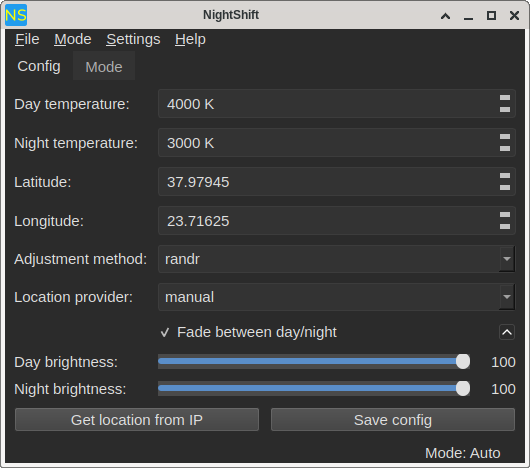

# NightShift

A Qt frontend for Redshift and Gammastep. Switch between automatic day/night color temperature adjustment and manual control, with a system tray icon and a config editor.

## Features

- Automatic mode using redshift or gammastep, driven by a config file
- Manual mode with live temperature and brightness sliders
- Config editor for temperature, brightness, location, and adjustment method
- System tray icon with show/hide and mode switching
- Dark theme with light theme option
- X11 and Wayland backend support (Wayland requires a wlr-based compositor)
- Autostart on login
- Start minimized option
- Single-instance enforcement

## Requirements

- Qt 6 (Widgets, Network)
- CMake 3.16 or later
- C++17 compiler
- redshift (for X11) and/or gammastep (for Wayland)

## Build

    cmake -B build -DCMAKE_BUILD_TYPE=Release
    cmake --build build -j$(nproc)

## Install

    sudo cmake --install build

Installs the binary to /usr/local/bin/nightshift.

## Run

    nightshift

Or with the start-minimized flag:

    nightshift --start-minimized

## Configuration

The app reads and writes the standard config files used by the underlying tools:

- X11: ~/.config/redshift.conf
- Wayland: ~/.config/gammastep/config.ini

On first run, if either file exists, it is backed up with a .nightshiftbak suffix before the app writes to it.

The app's own preferences (dark theme, start minimized, autostart, Wayland mode) are stored in QSettings at ~/.config/Alamahant/NightShift.conf.

## Wayland support

Wayland mode uses gammastep and the wlr-gamma-control protocol. This works on wlr-based compositors such as Sway, Hyprland, River, and Wayfire. It does not work on GNOME (Mutter) or KDE (KWin) Wayland sessions, which do not expose the protocol.

Enable Wayland mode from the checkbox in the menu bar. The application will prompt for a restart to apply the change.

## Autostart

Enable "Start on login" from the Settings menu. This writes a .desktop file to ~/.config/autostart/.

## License

Copyright (C) 2026 Alamahant

GPL-3.0-or-later

## Author

Alamahant